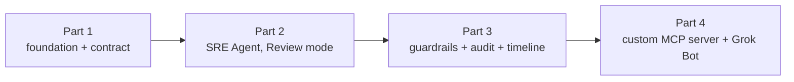

# How to Make My Job Obsolete: Creating an Infrastructure Agent

Code for my four-part blog series on [gisli78.substack.com](https://gisli78.substack.com). The series builds an
AI infrastructure agent on Azure that does the day-to-day work of an infrastructure specialist: it watches a
monitoring baseline, scales a workload inside an operating contract, can't step outside its guardrails, leaves an
audit trail, and answers questions from a chat app through a custom MCP server.

Author: **Gísli Guðmundsson**, Microsoft MVP, Iceland.

> Status: all four parts are written and validated offline (`scripts/validate.sh`: Bicep build, lint and
> build-params, KQL checks, Python tests, MCP Inspector). On 25 Nov 2026 I deployed parts 1–4 end to end to a live
> subscription in Sweden Central: foundation, governance (Audit), the MCP server and, briefly, the SRE Agent. I
> load-tested it until it scaled 1 → 10 replicas and called the MCP tools over HTTPS. The bugs that run found are fixed
> (MCP server 1.0.2). Always run `what-if` first.

## The series

1. **The Plan and the Foundation.** The operating contract as a Bicep type and `aiops-*` tags, a container app with
   HTTP and CPU scale rules, monitoring, dynamic-threshold and guardrail alerts, and deployment stacks.
   Folders: `infra/main.bicep`, `infra/modules/`, `infra/types/`.
2. **Hiring the Agent.** Azure SRE Agent with read-only roles on one resource group, Review mode, a job description and
   an hourly baseline task. Folders: `infra/agent/`, `agent/`.
3. **Guardrails, Audit and the Timeline Page.** Tool access policies, Azure Policy for the contract, Activity Log
   export, alerts that watch the watcher, KQL, and a timeline page that explains every scale event.
   Folders: `infra/governance/`, `queries/`, `agent/guardrails.md`.
4. **Talking to My Infrastructure Through a Custom MCP Server.** A remote MCP server on Container Apps (Streamable
   HTTP, API key per client), eight read tools and one bounded write tool, used from Grok Bot and SRE Agent.
   Folders: `mcp-server/`, `infra/mcp/`, `docs/connect-chat-assistant.md`.



See `docs/architecture.md` for the full picture.

## Requirements

- An Azure subscription where you can create resource groups and role assignments (Owner, or Contributor plus
  User Access Administrator, on the resource group). Part 3 needs Resource Policy Contributor and Monitoring
  Contributor at subscription scope, or Owner.
- Azure CLI 2.61.0 or later (deployment stacks), Bicep CLI (validated with 0.48.1).
- Resource providers: `Microsoft.App`, `Microsoft.OperationalInsights`, `Microsoft.Insights`,
  `Microsoft.ManagedIdentity`, `Microsoft.ContainerRegistry` (these are the namespaces the Bicep deploys).
- A region where Azure SRE Agent is available. Sweden Central is in every list I checked; confirm in the portal.
- Python 3.12 or later for the MCP server and its tests.

## Quick start

```bash
RG=rg-aiops-demo; LOC=swedencentral
az group create -n $RG -l $LOC

./scripts/validate.sh                         # no Azure needed
./scripts/what-if.sh $RG foundation           # preview
./scripts/deploy-stack.sh $RG foundation      # part 1
./scripts/deploy-stack.sh $RG agent           # part 2
./scripts/deploy-governance.sh $RG aiops $LOC Audit   # part 3
KEYS_FILE=./secrets/mcp-keys.txt ./scripts/deploy-mcp.sh $RG 1.0.2   # part 4: MCP URL + two API keys (file, mode 600)
```

Then follow `docs/connect-chat-assistant.md`.

## Layout

- `infra/` Bicep: foundation (`main.bicep`), `agent/`, `governance/`, `mcp/`, shared `modules/` and `types/`.
- `agent/` The agent's job description, scheduled task and guardrails.
- `mcp-server/` The custom MCP server (Python, MCP SDK 2.3.0), tests, Dockerfile, Inspector evidence.
- `queries/` KQL for the audit trail and Resource Graph.
- `scripts/` Deploy, what-if, validate, load generation, KQL checker.
- `docs/` Architecture, Azure MCP Server notes, connecting a chat assistant.

## Safety defaults

- The agent and the MCP server start with reader roles only.
- `set_scale_range` defaults to `dry_run=true`, needs `allowWrites=true` at deploy time (which also creates the one
  write role), only acts on apps with a valid contract in autonomous mode, and never changes production.
- Every MCP call is audited with the client name.

## License

MIT, see `LICENSE`.
