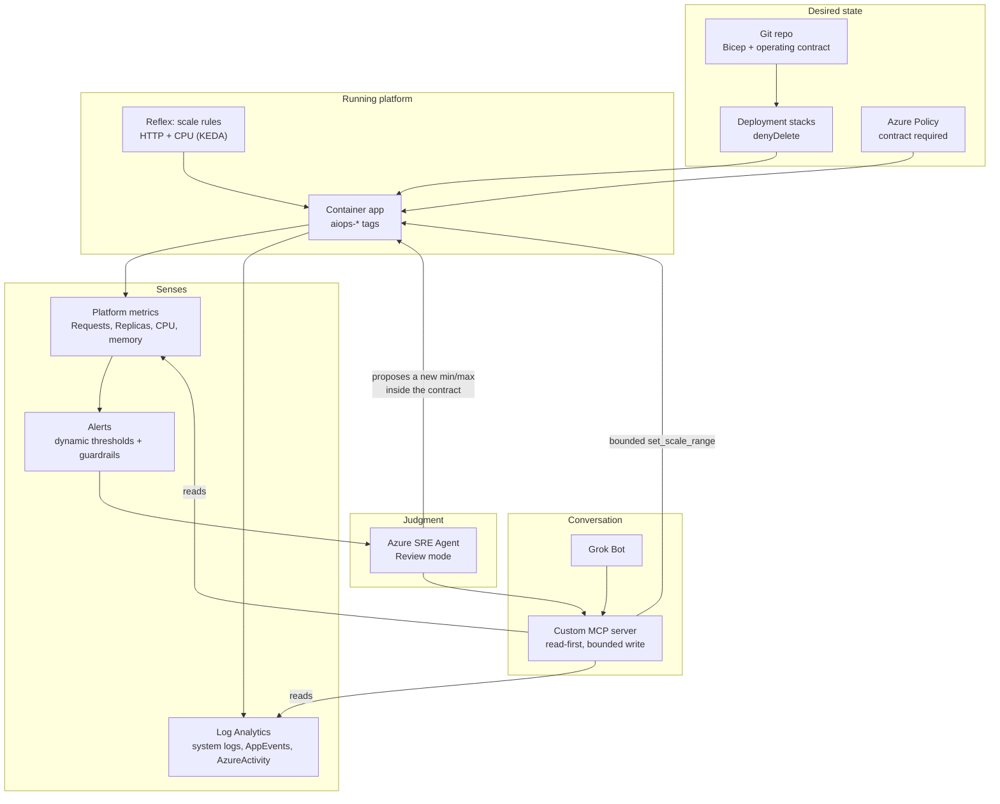
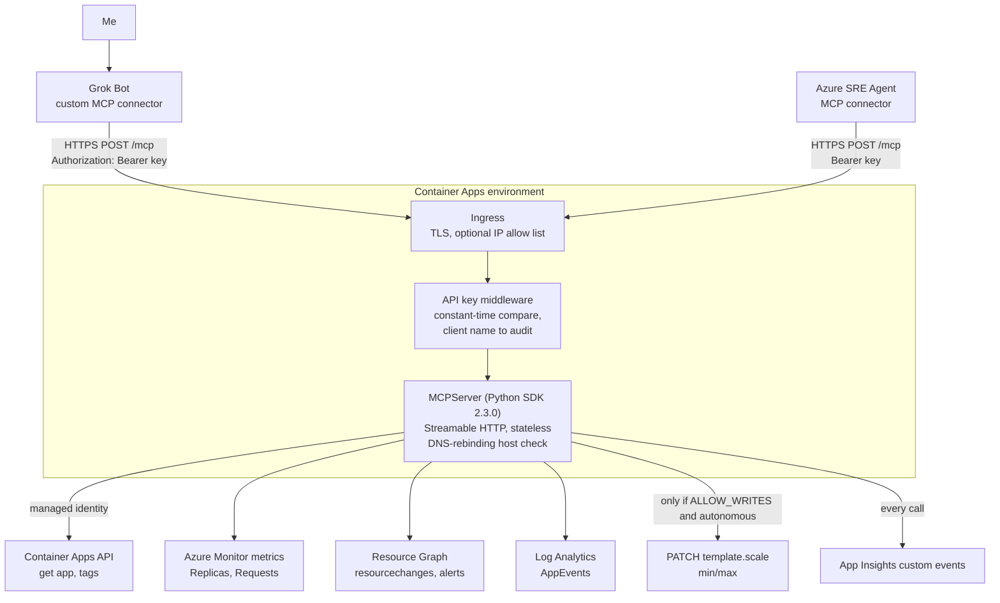

# Architecture

How the pieces of the series fit together. Every service named here was checked against Microsoft Learn on
25 November 2026.

## Layers

**Desired state.** Bicep in this repo, deployed as deployment stacks with `denyDelete`, and an Azure Policy that
makes the operating contract (`aiops-*` tags) mandatory and keeps production out of autonomous mode.

**Reflexes.** Container Apps scale rules (HTTP concurrency and CPU). They react in seconds and no AI sits in the
request path. The agent only changes the range (`minReplicas`, `maxReplicas`) they work within.

**Senses.** Platform metrics (`Requests`, `Replicas`, `UsageNanoCores`, `WorkingSetBytes`, `RestartCount`),
Log Analytics (Container Apps system logs, `AppEvents`, `AzureActivity`), dynamic-threshold alerts on requests,
CPU and memory, and static guardrail alerts (replicas at the ceiling, 5xx, restarts).

**Judgment.** Azure SRE Agent in Review mode with read-only roles on one resource group, an hourly scheduled task
that compares the hour-of-week baseline with the contract, and a job description in `agent/`.

**Guardrails.** RBAC (nothing at subscription scope), tool access policies, run mode, Azure Policy, deny
settings, and the contract checks in the MCP server's code.

**Accountability.** SRE Agent's audit events, the MCP server's audit events, the Activity Log, Resource Graph
change history, and the timeline page that puts them on one page.

**Conversation.** A custom MCP server on Container Apps (Streamable HTTP, API key per client) that Grok Bot and
SRE Agent both use.

## MCP server

## Design rules

1. **Reflexes stay deterministic.** The agent never replaces the scaler. It changes the bounds the scaler works within.
2. **The contract lives on the resource**, as `aiops-*` tags generated from the exported Bicep type in
   `infra/types/contract.bicep`, and Azure Policy makes it mandatory.
3. **Code is the source of truth.** A runtime change inside the contract is allowed. A permanent change goes
   through a pull request against the Bicep.
4. **Read first.** Every identity starts with reader roles. Write access is one role on one app, and only when
   switched on.
5. **Production is always review.** Enforced in Azure Policy and in the MCP server.
6. **Every action leaves evidence**, and the timeline page shows it.
