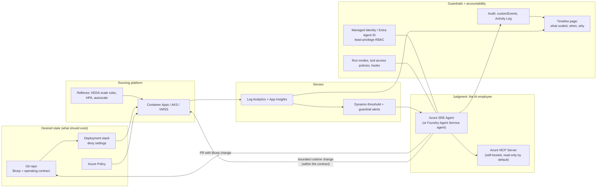

# Architecture: an AI ops agent that runs Azure infrastructure

Part 1 of the series. Everything here maps to an Azure service that exists today (checked against Microsoft Learn, November 2026).

## The layers

| Layer | Job | Azure services | Who acts |
|---|---|---|---|
| Desired state | Define what should exist and protect it | Bicep, deployment stacks (deny settings), Azure Policy | Pipeline, and the agent through pull requests |
| Reflexes | React to load in seconds, deterministically | Container Apps scale rules (KEDA), AKS HPA and cluster autoscaler, Azure Monitor autoscale | The platform. No AI in the hot path |
| Senses | Know what normal looks like and notice when it isn't | Log Analytics, Application Insights, dynamic-threshold alerts, Azure Copilot Observability Agent | Azure Monitor |
| Judgment | Investigate, decide, change the rules the reflexes work within | Azure SRE Agent, or a custom agent on Foundry Agent Service, with Azure MCP Server as the tool belt | The AI agent |
| Guardrails | Limit what the agent can do and prove what it did | Managed identity, Entra Agent ID, RBAC, run modes, tool access policies, hooks, deny settings | Platform team (once), then automatic |
| Accountability | Show every scale event and every agent decision with evidence | App Insights `customEvents`, Activity Log, AzureMetrics, a timeline page | Anyone |

## Design rules

1. **Reflexes stay deterministic.** The agent never sits in the request path and never replaces KEDA or HPA. It changes the bounds and rules they work within.
2. **The contract lives on the resource.** Every managed workload carries `aiops-*` tags (min/max replicas, change mode, owner, SLO, budget). See `infra/types/contract.bicep`.
3. **Code is the source of truth.** Permanent changes go through a pull request against the Bicep. Runtime changes are allowed only inside the contract and get written back to code.
4. **Read-only first.** The agent's identity starts with Reader-level roles and Review mode. Autonomy is earned per task, not granted per agent.
5. **Every action leaves evidence.** If it isn't in the audit trail and on the timeline, it didn't happen.
